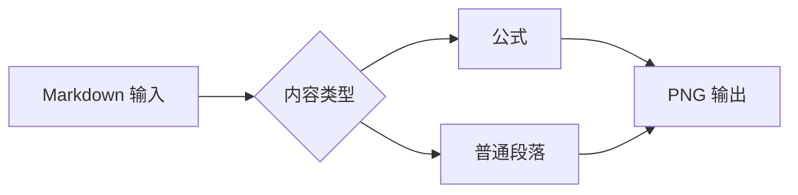
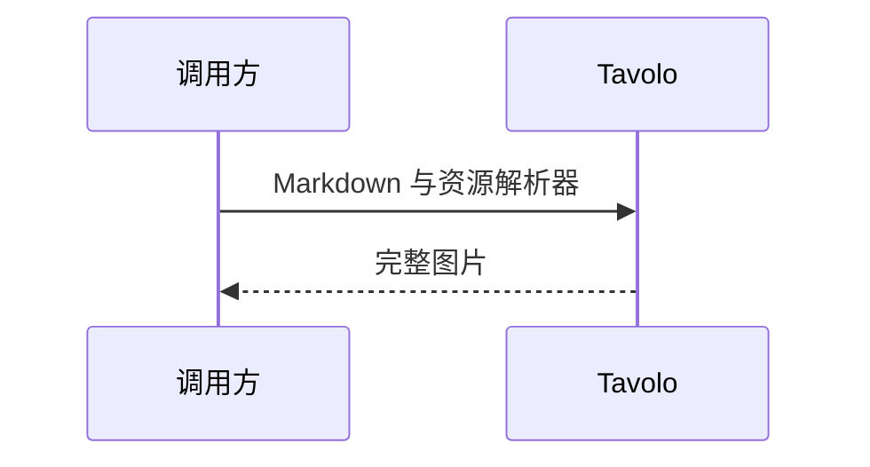

# GitHub Markdown 功能验收

中文、**粗体**、*斜体*、***粗斜体***、~~删除~~、`行内代码`、:rocket: :+1: :family_man_woman_girl_boy:。

自动链接：https://example.com，以及 hello@example.com。括号（www.example.org）和中文路径 https://example.com/中文路径。引用：@octocat、#7。

## 任务、提示与脚注

- [x] 已完成的任务，含 **强调**
- [ ] 未完成的任务
  - [x] 嵌套任务

> [!NOTE]
> 说明，含行内公式 $x^2+y^2=z^2$。

> [!TIP]
> 推荐做法，保留中文正文。

> [!IMPORTANT]
> 重要信息。

> [!WARNING]
> 注意风险。

> [!CAUTION]
> 谨慎操作。

先引用脚注[^second]，再次引用[^second]，然后引用另一条[^first]。

## 行内公式与块级公式

文字之前 $\frac{a_1+b_2}{\sqrt{1+x^2}}$ 文字之后，公式需要与正文对齐。另一个写法 $`a*b + c_d`$ 不应被 Markdown 强调语法破坏。

普通美元符号：\$5，代码内不解析：`$not_math$`，`:rocket:`。

$$
\int_0^1 x^2\,dx=\frac{1}{3},\qquad
\sum_{n=1}^{\infty}\frac{1}{n^2}=\frac{\pi^2}{6}
$$

```math
\begin{pmatrix}a&b\\c&d\end{pmatrix}
\quad f(x)=\begin{cases}x^2&x\ge0\\-x&x<0\end{cases}
```

```math
\begin{equation}E=mc^2\tag{1}\end{equation}
```

```math
\require{mhchem}\ce{CO2 + C -> 2CO}\qquad\text{反应}
```

```math
\require{physics}\dv{x}{t}\qquad\textcolor{red}{a+b}
```

## HTML 与图片混排

<p align="center"><b>居中的标题</b><br>HTML 换行、<ins>下划线</ins>、<kbd>Ctrl</kbd> + <kbd>K</kbd>。</p>

<p>水 H<sub>2</sub>O，面积 x<sup>2</sup>，<mark>标记文字</mark>，<small>小字</small>，<ruby>汉字<rt>hàn zì</rt></ruby>。</p>

<p>行内图片  后续文字，图片不能强制拆成独立段落。</p>

<picture>
  <source media="(prefers-color-scheme: dark)" srcset="fixture:dark">
  <source media="(prefers-color-scheme: light)" srcset="fixture:light">
  
</picture>

<details>
<summary>折叠区摘要：静态图片中展开</summary>

正文必须出现，包含 **Markdown 强调**。

- 嵌套列表
- 数学公式 $a+b=c$

<details><summary>内层摘要</summary><p>内层正文。</p></details>
</details>

<dl><dt>术语</dt><dd>解释正文，包含 <em>强调</em>。</dd></dl>

<table>
<caption>HTML 合并单元格</caption>
<tr><th colspan="2">名称与说明</th><th>结果</th></tr>
<tr><td rowspan="2">共享分类</td><td>第一项</td><td>通过</td></tr>
<tr><td>第二项</td><td>通过</td></tr>
</table>

| 左对齐 | 居中 | 右对齐 |
| :--- | :---: | ---: |
| **中文** | $x_1$ | 123 |
| `code` | :rocket: | 456 |

## 代码高亮与长行

```kotlin
// 中文注释与空格必须保留
val message = "Hello  Tavolo"
fun square(x: Int): Int = x * x
val longName = "abcdefghijklmnopqrstuvwxyz_ABCDEFGHIJKLMNOPQRSTUVWXYZ_0123456789_abcdefghijklmnopqrstuvwxyz"
```

```unknown-language
未知语言照常显示代码：  a  b `c`
```

## Mermaid





[^first]: 第二个编号的脚注，定义位置不决定编号。
[^second]: 第一个编号的脚注，**只显示一份正文**。

    第二段脚注内容，包含 `code`。

末尾完整性标记：全部内容结束。
