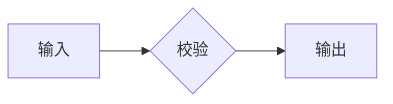

# 行内排版验收

普通文字`inline_code`后续文字，连续代码 `first`、`second`；🚀 Emoji 后的 `code` 也应有完整圆角。

混排文字 `code` 与 $\frac{a_1+b_2}{\sqrt{1+x^2}}$，公式后继续文字，再接 `tail`。

较长代码 `abcdefghijklmnopqrstuvwxyz_ABCDEFGHIJKLMNOPQRSTUVWXYZ_0123456789_abcdefghijklmnopqrstuvwxyz` 自动换行，前后文字不被背景遮住。

- [x] 已完成任务，包含 `inline_code`
- [ ] 待完成任务，包含分数 $\frac{1}{1+\frac{1}{x}}$ 和后续文字
  - [x] 嵌套任务，文字足够长时换行，图标仍与第一行对齐，而不是跟随整个任务项居中。

连续正文与公式 $x^2+y^2=z^2$；较高公式 $\frac{\sum_{i=1}^{n}i^2}{\sqrt{1+x^2}}$，文字基线应保持一致。

带描边的数学符号仍应保留：$\cancel{x}+\enclose{circle}{y}$。

